<!-- WEEK6_PART1 -->
# Week 6: Energy-based Models

## Environment
- Python 3.12 (uv virtual environment)
- NumPy, Matplotlib, JAX
- CPU execution

## Part 1: Understand the Datasets

### Dataset sources

**MNIST**
- Source: https://storage.googleapis.com/cvdf-datasets/mnist
- Training: 60,000 images
- Test: 10,000 images
- Resolution: 28 x 28 grayscale
- Pixel values: 0 to 255
- Original train/test splits are preserved.

**CIFAR-10**
- Source: https://cave.cs.toronto.edu/kriz/cifar-10-binary.tar.gz
- Training: 50,000 images
- Test: 10,000 images
- Resolution: 32 x 32 RGB
- Pixel values: 0 to 255
- Original train/test splits are preserved.

The datasets are stored in inputs/ and excluded from Git.

### Reproduce the experiment

From the week6 directory, run:

```bash
uv run --no-project --python .venv/bin/python src/part1_datasets.py
```

This command generates all four figures below.

### Evidence

**1. MNIST image gallery**

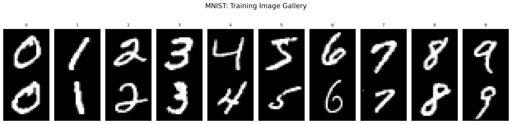

The gallery contains two handwritten examples from each digit
class. Different handwriting styles can be observed within a class.
Images are displayed without smoothing interpolation.

**2. MNIST class frequencies**

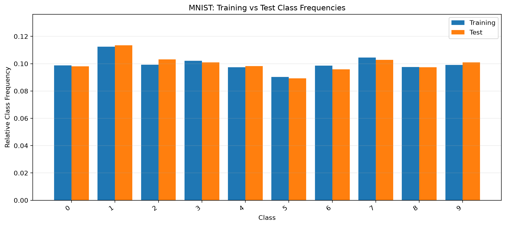

MNIST is not perfectly class-balanced. Digit 1 is the most
frequent and digit 5 is the least frequent in both splits.
The training and test distributions are similar but not identical.

**3. CIFAR-10 image gallery**

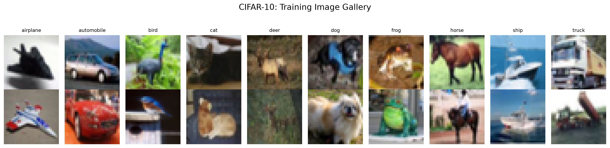

The gallery displays two RGB images from each object class.
Some fine details are difficult to recognize because the
original resolution is only 32 x 32 pixels.

**4. CIFAR-10 class frequencies**

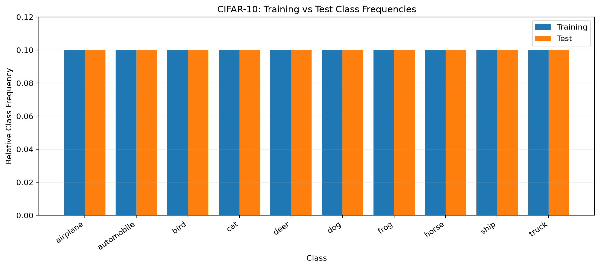

All ten classes are exactly balanced.
Each class contains 5,000 training examples and 1,000 test
examples, corresponding to a relative frequency of 0.1.

### Conclusion

MNIST and CIFAR-10 have different image representations
and class distributions. MNIST contains grayscale handwritten
digits with unequal class frequencies, while CIFAR-10 contains
low-resolution color photographs with balanced classes.

The galleries show differences in image appearance, whereas
class-frequency plots describe the empirical label distributions.

These datasets will be reused in later experiments.


<!-- WEEK6_PART2 -->
## Part 2: Generative RBM for Handwritten Digits

### Model and training

The RBM contains 784 visible units and 128 hidden units.
MNIST pixels are binarized at intensity 128 and represented
as spins s = 2v - 1.

Both models use 20 epochs, batch size 100, learning rate 0.1,
the same initialization and the same training-data order.
Only the CD chain length differs (CD-1 versus CD-10).

### Reproduction commands

Run from the week6 directory, in this order:

```bash
.venv/bin/python src/part2_spins.py
.venv/bin/python src/part2_train_rbm.py
.venv/bin/python src/part2_generation.py
.venv/bin/python src/part2_completion.py
```

### Evidence

**Binarized MNIST images**

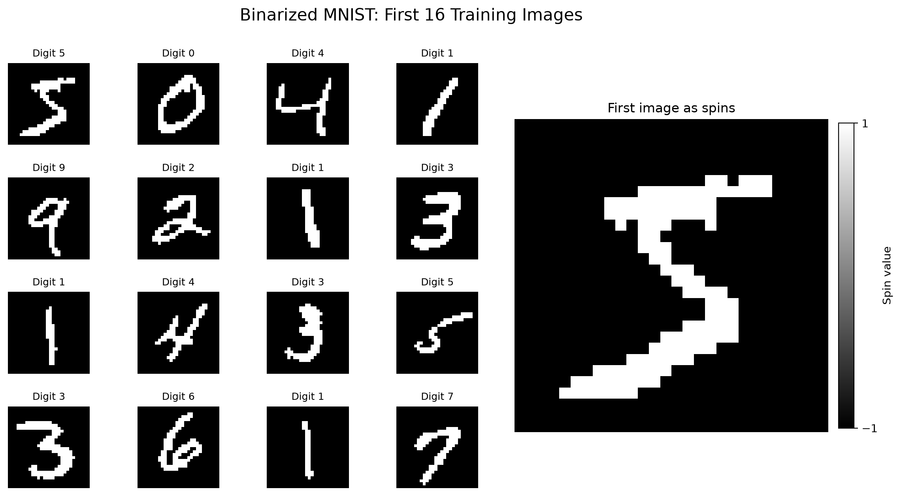

**RBM visible and hidden layers**

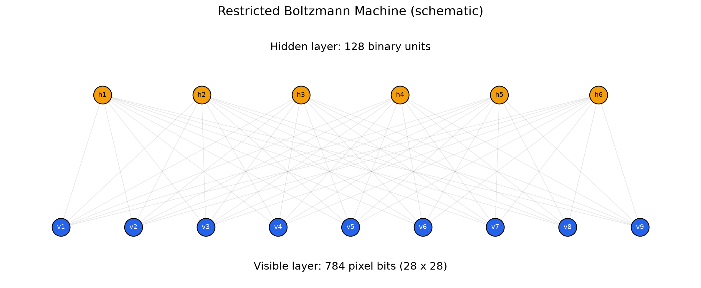

**Training diagnostics**

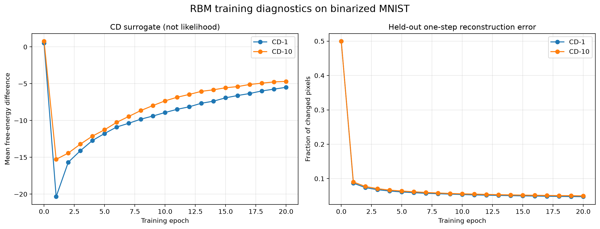

The CD surrogate is not the exact negative log-likelihood.
Reconstruction error decreases substantially during training.

**Held-out one-step reconstruction**

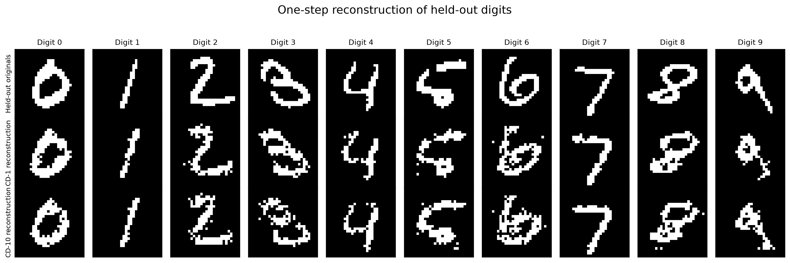

**Fresh generation from shared random starts**

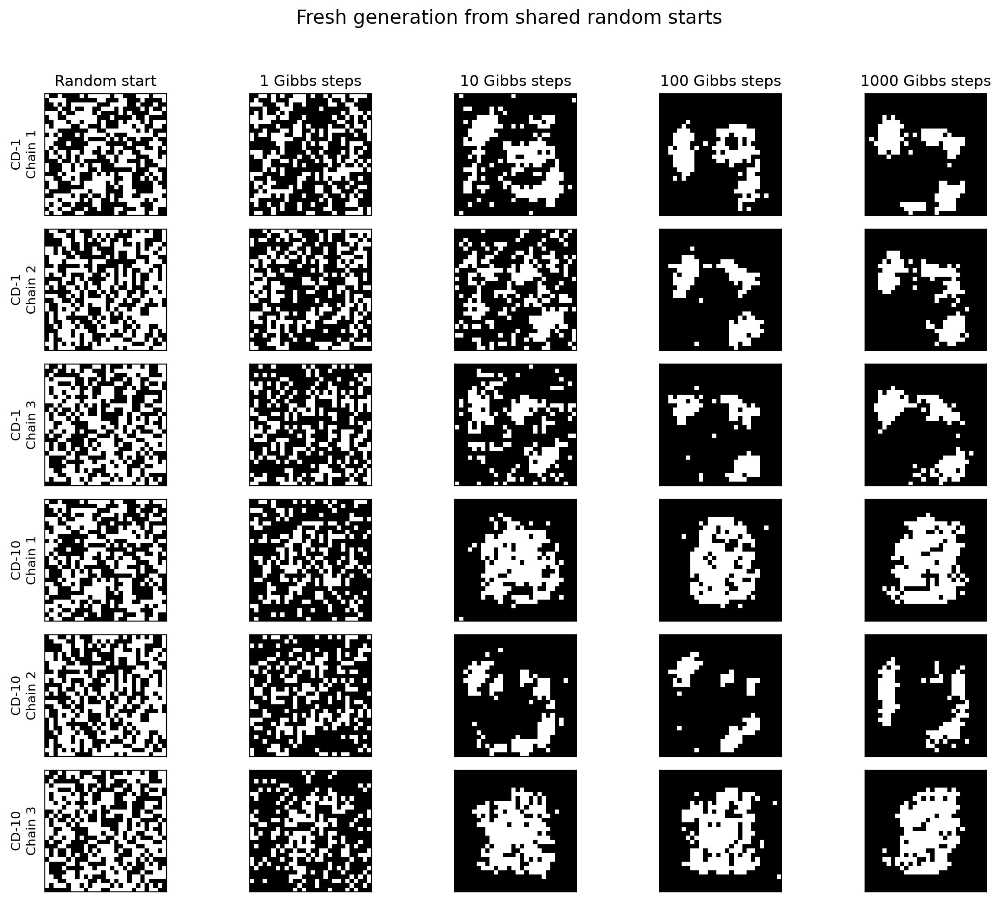

Reconstructions retain input-digit information, while fresh
generation starts from random configurations. Generated
samples develop connected stroke-like structures but need
not become recognizable digits.

**Clamped Gibbs image completion**

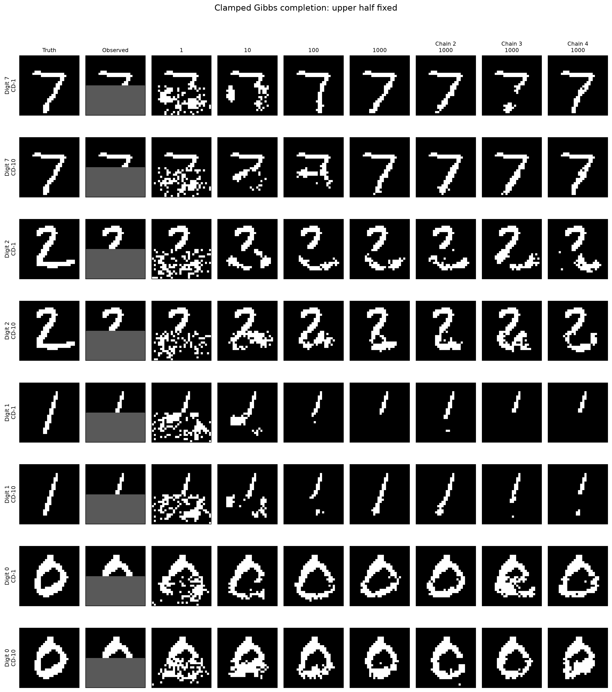

**Ink-overlap comparison**

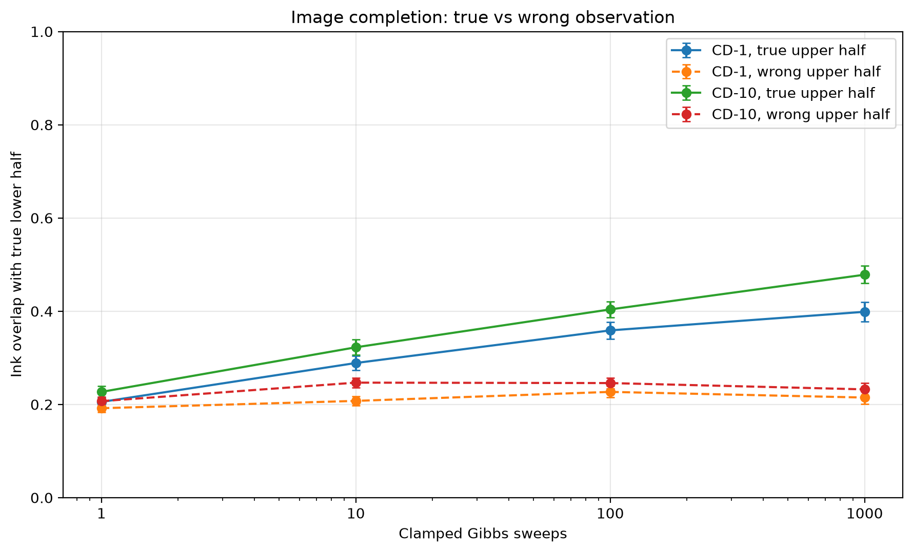

### Quantitative results

| Model | Initial reconstruction error | Final reconstruction error | True upper overlap | Wrong upper overlap | Gap | Criterion |
|---|---:|---:|---:|---:|---:|---|
| CD-1 | 0.4994 | 0.0476 | 0.3987 | 0.2148 | 0.1840 | PASS |
| CD-10 | 0.4996 | 0.0498 | 0.4783 | 0.2323 | 0.2460 | PASS |

The overlap values refer to 1000 clamped Gibbs sweeps.
Means were calculated over 64 held-out digits with eight
chains per digit.

### Conclusion

Both CD-1 and CD-10 improve one-step reconstruction.
However, a good reconstruction does not establish good
fresh generation. The longer-trained CD-10 model gives
better conditional completion in this experiment.

Clamping the observed upper half converts unconstrained
sampling into conditional inference of the missing pixels.

