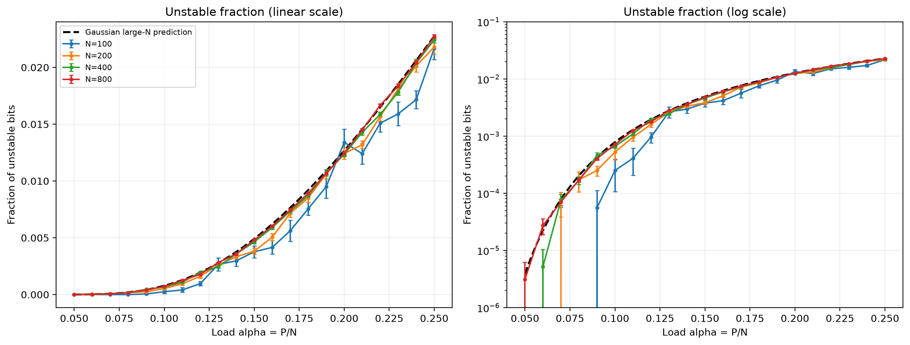
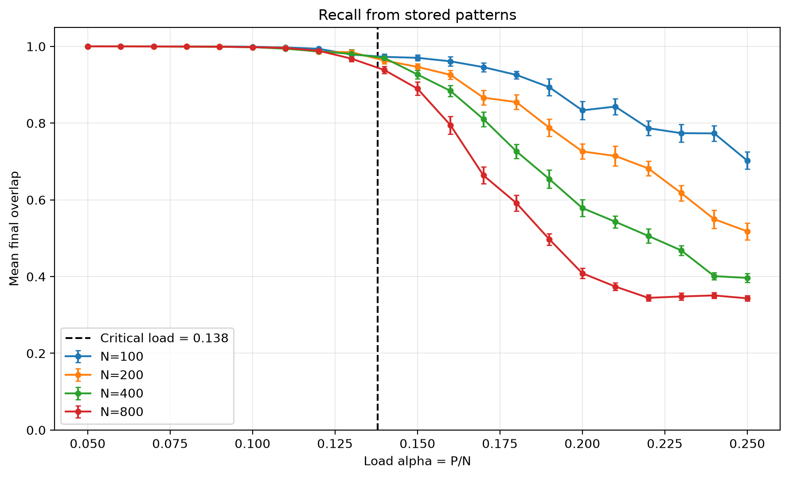
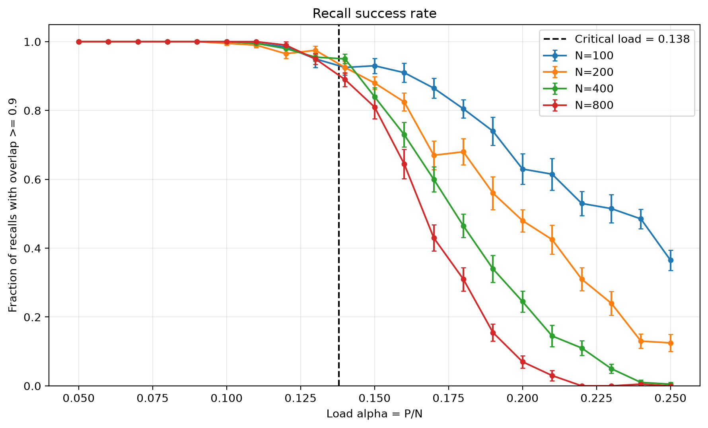
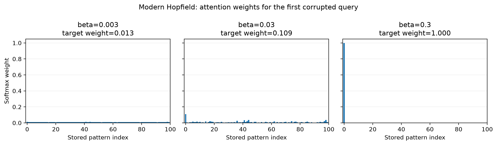
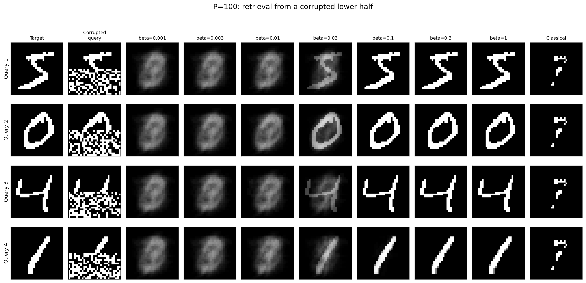
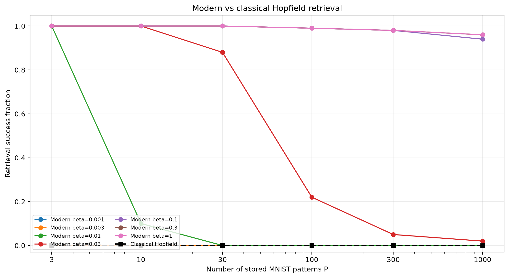

<!-- WEEK6_PART1 -->
# Week 6: Energy-based Models

## Environment
- Python 3.12 (uv virtual environment)
- NumPy, Matplotlib, JAX
- CPU execution

## Part 1: Understand the Datasets

### Dataset sources

**MNIST**
- Source: https://storage.googleapis.com/cvdf-datasets/mnist
- Training: 60,000 images
- Test: 10,000 images
- Resolution: 28 x 28 grayscale
- Pixel values: 0 to 255
- Original train/test splits are preserved.

**CIFAR-10**
- Source: https://cave.cs.toronto.edu/kriz/cifar-10-binary.tar.gz
- Training: 50,000 images
- Test: 10,000 images
- Resolution: 32 x 32 RGB
- Pixel values: 0 to 255
- Original train/test splits are preserved.

The datasets are stored in inputs/ and excluded from Git.

### Reproduce the experiment

From the week6 directory, run:

```bash
uv run --no-project --python .venv/bin/python src/part1_datasets.py
```

This command generates all four figures below.

### Evidence

**1. MNIST image gallery**


The gallery contains two handwritten examples from each digit
class. Different handwriting styles can be observed within a class.
Images are displayed without smoothing interpolation.

**2. MNIST class frequencies**


MNIST is not perfectly class-balanced. Digit 1 is the most
frequent and digit 5 is the least frequent in both splits.
The training and test distributions are similar but not identical.

**3. CIFAR-10 image gallery**


The gallery displays two RGB images from each object class.
Some fine details are difficult to recognize because the
original resolution is only 32 x 32 pixels.

**4. CIFAR-10 class frequencies**


All ten classes are exactly balanced.
Each class contains 5,000 training examples and 1,000 test
examples, corresponding to a relative frequency of 0.1.

### Conclusion

MNIST and CIFAR-10 have different image representations
and class distributions. MNIST contains grayscale handwritten
digits with unequal class frequencies, while CIFAR-10 contains
low-resolution color photographs with balanced classes.

The galleries show differences in image appearance, whereas
class-frequency plots describe the empirical label distributions.

These datasets will be reused in later experiments.


<!-- WEEK6_PART2 -->
## Part 2: Generative RBM for Handwritten Digits

### Model and training

The RBM contains 784 visible units and 128 hidden units.
MNIST pixels are binarized at intensity 128 and represented
as spins s = 2v - 1.

Both models use 20 epochs, batch size 100, learning rate 0.1,
the same initialization and the same training-data order.
Only the CD chain length differs (CD-1 versus CD-10).

### Reproduction commands

Run from the week6 directory, in this order:

```bash
.venv/bin/python src/part2_spins.py
.venv/bin/python src/part2_train_rbm.py
.venv/bin/python src/part2_generation.py
.venv/bin/python src/part2_completion.py
```

### Evidence

**Binarized MNIST images**


**RBM visible and hidden layers**


**Training diagnostics**


The CD surrogate is not the exact negative log-likelihood.
Reconstruction error decreases substantially during training.

**Held-out one-step reconstruction**


**Fresh generation from shared random starts**


Reconstructions retain input-digit information, while fresh
generation starts from random configurations. Generated
samples develop connected stroke-like structures but need
not become recognizable digits.

**Clamped Gibbs image completion**


**Ink-overlap comparison**


### Quantitative results

| Model | Initial reconstruction error | Final reconstruction error | True upper overlap | Wrong upper overlap | Gap | Criterion |
|---|---:|---:|---:|---:|---:|---|
| CD-1 | 0.4994 | 0.0476 | 0.3987 | 0.2148 | 0.1840 | PASS |
| CD-10 | 0.4996 | 0.0498 | 0.4783 | 0.2323 | 0.2460 | PASS |

The overlap values refer to 1000 clamped Gibbs sweeps.
Means were calculated over 64 held-out digits with eight
chains per digit.

### Conclusion

Both CD-1 and CD-10 improve one-step reconstruction.
However, a good reconstruction does not establish good
fresh generation. The longer-trained CD-10 model gives
better conditional completion in this experiment.

Clamping the observed upper half converts unconstrained
sampling into conditional inference of the missing pixels.


<!-- WEEK6_PART3 -->
## Part 3: Hopfield Network Storage Capacity

### Method

Random spin patterns are stored using the Hebbian rule,
with J_ii = 0.

Recall uses zero-temperature asynchronous updates
until a sweep produces no spin flips.

We tested N = 100, 200, 400, 800 and load values
from 0.05 to 0.25 in steps of 0.01, with 20
independent pattern sets per point.

### Reproduction

```bash
.venv/bin/python src/part3_hopfield_check.py
.venv/bin/python -u src/part3_capacity.py
```

### Evidence

**Unstable-bit fraction and Gaussian crosstalk prediction**



**Mean final overlap after recall**



**Recall success probability, overlap >= 0.9**



### Capacity results

| Number of spins N | Estimated overlap=0.9 crossing |
|---|---|
| 100 | 0.1880 |
| 200 | 0.1644 |
| 400 | 0.1563 |
| 800 | 0.1479 |

The theoretical critical load is alpha_c approximately 0.138.
The crossing estimates use linear interpolation between
neighboring experimental load points.

### Conclusion

The measured unstable-bit fraction approximately follows
the Gaussian crosstalk prediction, with finite-size effects
more visible for small N.

Recall is reliable at low load, but deteriorates as
more patterns are stored. The transition becomes sharper
and approaches the theoretical critical load as N grows.


<!-- WEEK6_PART4 -->
## Part 4: Modern Hopfield Networks and Attention

### Method

Binarized MNIST images are stored as spin patterns.
Each query retains the original upper half and replaces
its lower half with random spins.

Modern Hopfield retrieval uses:

    x_new = X softmax(beta X^T x)

This update is equivalent to softmax attention when
the stored patterns are both keys and values,
with attention scale beta.

The classical Hopfield network is evaluated on
the same stored patterns and corrupted queries.

### Reproduction

Run these commands from week6/:

```bash
.venv/bin/python src/part4_attention_check.py
.venv/bin/python src/part4_retrieval.py
```

### Evidence

**Softmax weights across inverse temperatures**



With increasing beta, attention weights concentrate
on the most similar stored pattern.

**Digit retrieval comparison**



Small beta produces an average of stored images.
Larger beta retrieves individual stored digits.
Classical Hopfield recall fails for these highly
correlated digit patterns.

**Retrieval success**



### Attention numerical equivalence

| Beta | Maximum absolute difference |
|---|---|
| 0.003 | 5.9604645e-07 |
| 0.03 | 5.364418e-07 |
| 0.3 | 1.7881393e-07 |

### Retrieval success

| Stored patterns P | Modern beta=0.3 | Classical |
|---|---:|---:|
| 3 | 100.00% | 0.00% |
| 10 | 100.00% | 0.00% |
| 30 | 100.00% | 0.00% |
| 100 | 99.00% | 0.00% |
| 300 | 98.00% | 0.00% |
| 1000 | 96.00% | 0.00% |

### Conclusion

Modern Hopfield retrieval is equivalent to a
softmax-attention operation with the appropriate scale.

Increasing inverse temperature changes retrieval
from averaging stored patterns to selecting the
most similar pattern.

Modern retrieval is effective for correlated MNIST
digits even when classical Hopfield recall fails.

