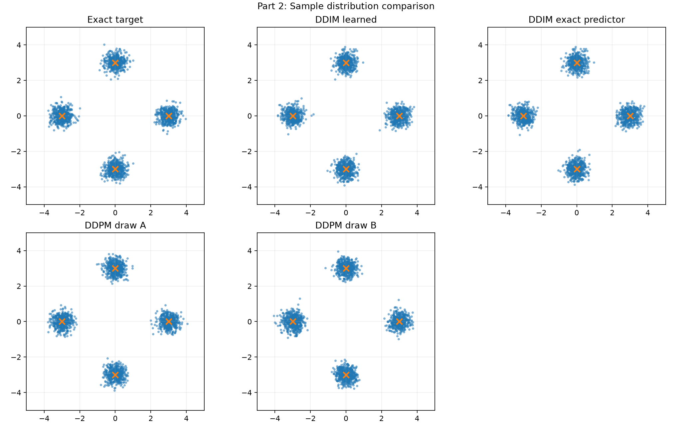
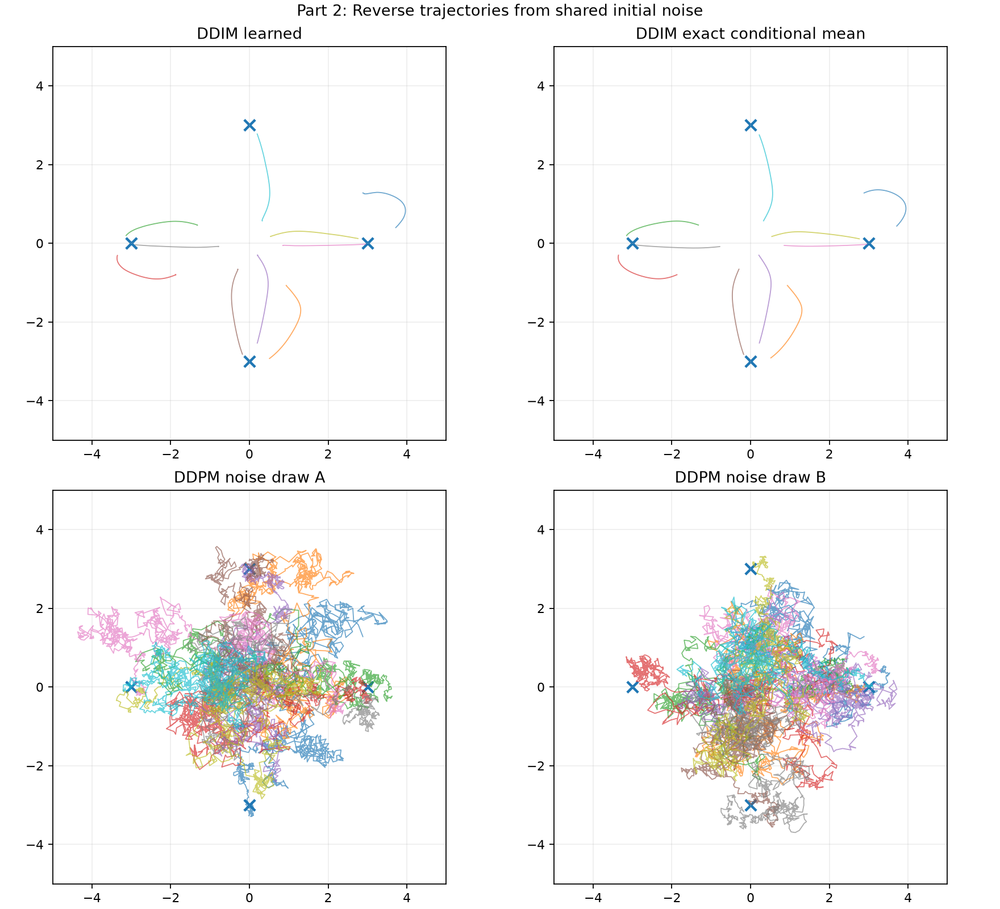
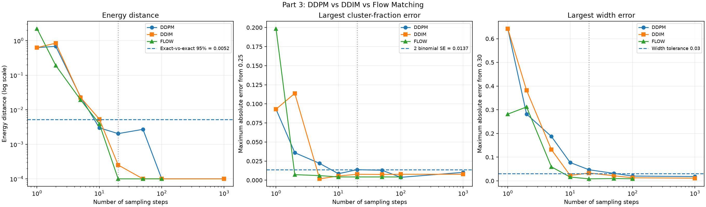
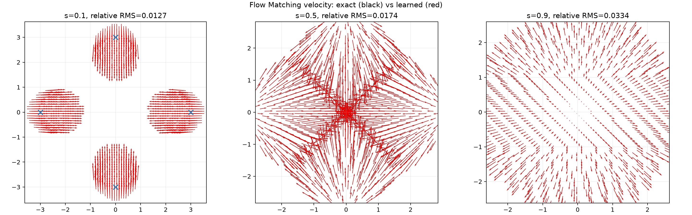
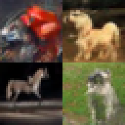
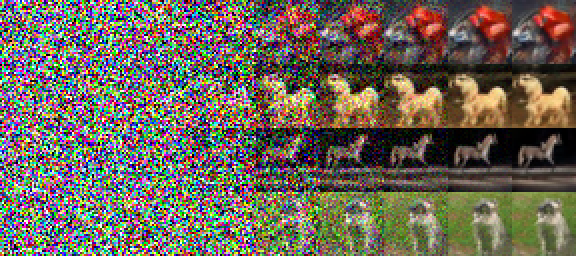
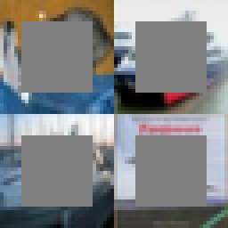
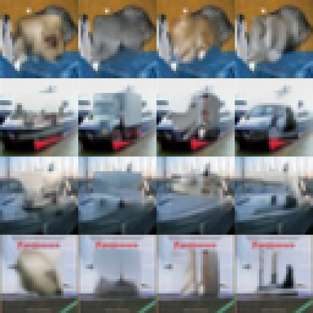
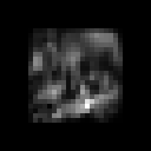

# Week 7: Diffusion and Flow Matching

## Part 1 - Diffusion Models on a Gaussian Mixture

### Implementation
- JAX noise predictor with time conditioning
- Four equally weighted Gaussian components
- 1000-step forward diffusion
- 25000 training updates, batch size 512
- Linear learning-rate decay
- DDPM reverse sampling without clipping
- 10 saved training stages

### Results
- Evaluation samples: 2000
- Final training loss: 0.2081
- Cluster populations: 0.2550, 0.2505, 0.2380, 0.2565
- Maximum centre-coordinate error: 0.0272
- Maximum per-coordinate spread error: 0.0121
- Forward terminal mean: 0.0168, -0.0078
- Forward terminal variance: 1.0985, 1.0224

The cluster population, centre and spread checks passed.
The forward terminal variance also meets the stated tolerance,
although the first coordinate is close to the upper boundary.

### Evidence
- evidence/forward_diffusion.png
- evidence/forward_diffusion.gif
- evidence/training_stages.gif
- evidence/generated_vs_target.png
- evidence/reverse_diffusion.gif

### Reproduce
Run from the week7 directory:
JAX_PLATFORMS=cpu .venv/bin/python src/part1_diffusion.py


<!-- AUTO-GENERATED WEEK 7 PARTS 2-5: edit source metrics, then rerun helper -->

## Part 2: DDIM deterministic sampling

**Run:** `JAX_PLATFORMS=cpu .venv/bin/python src/part2_ddim.py`

The same trained noise predictor from Part 1 is reused for DDIM and DDPM comparisons. DDIM contains no extra reverse-step noise, whereas DDPM is stochastic.

- Maximum difference between repeated DDIM runs from identical initial noise: **0.00000**.
- DDIM repeatability check: **PASS**.
- Fraction of samples assigned to the same cluster between two DDPM reverse-noise draws: **0.2495**.

- Learned DDIM: maximum fraction error **0.0080**, width check **NOT PASSED**.
- Exact-predictor DDIM: maximum fraction error **0.0095**, width check **NOT PASSED**.
- DDPM, reverse noise A: maximum fraction error **0.0210**, width check **NOT PASSED**.
- DDPM, reverse noise B: maximum fraction error **0.0185**, width check **NOT PASSED**.

The deterministic repeatability test passes; some strict cluster-width tests do **not** pass. They are reported rather than relabelled as successful.

**Part 2: generated sample distributions**




**Part 2: reverse sampling paths**




## Part 3: Flow Matching and sampler comparison

**Run:** `JAX_PLATFORMS=cpu .venv/bin/python src/part3_flow_matching.py`

A newly initialized time-conditioned network learns the flow-matching velocity between a four-component Gaussian mixture and standard Gaussian noise. Euler integration transports samples from noise to the data distribution. DDIM and DDPM reuse Part 1's noise predictor.

- Final flow training updates: **100000**.
- Energy-distance null reference (95% quantile): **0.005215**.

### Flow velocity agreement on the data-support grid

The grid includes points in regions with non-negligible interpolated-data density. A separate full-square diagnostic includes low-probability regions and produced larger errors; both findings are retained in the raw results.

| Interpolation time s | Relative RMS error | Below 0.1 |
|---|---:|:---:|
| 0.1 | 0.01272 | PASS |
| 0.5 | 0.01743 | PASS |
| 0.9 | 0.03344 | PASS |

### 20-step sampler comparison

| Sampler | Energy distance (finite-sample estimate) | Max. cluster fraction error | Max. width error | Width tolerance passed |
|---|---:|---:|---:|:---:|
| DDPM | 0.002035 | 0.01375 | 0.04688 | NOT PASSED |
| DDIM | 0.000252 | 0.00775 | 0.03300 | NOT PASSED |
| Flow Matching | -0.000159 | 0.00425 | 0.00845 | PASS |

Because the reported energy distance uses a finite-sample unbiased estimator, small negative estimates can occur; a population energy distance cannot be negative.

**Part 3: quality versus sampling steps**




**Part 3: exact and learned velocity fields**




## Part 4: Pretrained CIFAR-10 diffusion model

**Forward test:** `JAX_PLATFORMS=cpu .venv/bin/python src/part4_cifar10_ddpm_jax.py --check`

**Generate four images:** `JAX_PLATFORMS=cpu .venv/bin/python src/part4_cifar10_ddpm_jax.py --run`

The noise predictor is a frozen U-Net trained on CIFAR-10 photographs. The network and pretrained weights are not trained further here: the sampler independently implements the 1000-step DDPM reverse updates in JAX, with model index t-1, float32, no state clipping, and no added noise at the last step.

**Model provenance:** `google/ddpm-cifar10-32`, pinned Hugging Face revision `267b167dc01f0e4e61923ea244e8b988f84deb80`.

**Reproduce model download:**

```bash
uv run --with huggingface-hub==1.33.0 hf download google/ddpm-cifar10-32 \
  config.json diffusion_pytorch_model.safetensors \
  --revision 267b167dc01f0e4e61923ea244e8b988f84deb80 \
  --local-dir inputs/cifar-model
```

The weights are local inputs and must not be committed to Git. The final images look like recognizable low-resolution CIFAR-10-style objects. The earlier trajectory images are mostly noise, with meaningful shapes emerging late.

- Recorded sampler: **DDPM**; image count: **4**; steps: **1000**.

**Part 4: four generated photographs**




**Part 4: denoising trajectories for the four photographs**




## Part 5: RePaint inpainting of missing pixels

**Run:** `JAX_PLATFORMS=cpu .venv/bin/python src/part5_repaint_jax.py`

**Input:** `inputs/images.npz`, with four test images. For each 32x32 RGB test image the central 20x20 square (rows and columns `6:26`) is concealed. The visible pixels are incorporated by merging forward-noised observations at each current noise level. RePaint uses levels 1000,980,...,20,0, with two attempts per jump except the last, for 99 network evaluations per completion.

Four random seeds (7201, 7202, 7203, 7204) produce 16 total completions. Hidden-pixel mean squared error is measured only inside the removed square; pixelwise variance across seeds illustrates uncertainty in the unknown content.

- Recorded completions: **16** (expected 16).
- Hidden-pixel MSE across runs: mean **0.15427**, minimum **0.07551**, maximum **0.23793**.

### Hidden-pixel MSE per completion

| Image | Seed | Hidden-pixel MSE | Predictor evaluations |
|---:|---:|---:|---:|
| 1 | 7201 | 0.140135 | 99 |
| 1 | 7202 | 0.108249 | 99 |
| 1 | 7203 | 0.131448 | 99 |
| 1 | 7204 | 0.119286 | 99 |
| 2 | 7201 | 0.158779 | 99 |
| 2 | 7202 | 0.209859 | 99 |
| 2 | 7203 | 0.237929 | 99 |
| 2 | 7204 | 0.174662 | 99 |
| 3 | 7201 | 0.180882 | 99 |
| 3 | 7202 | 0.092902 | 99 |
| 3 | 7203 | 0.075513 | 99 |
| 3 | 7204 | 0.123053 | 99 |
| 4 | 7201 | 0.135039 | 99 |
| 4 | 7202 | 0.151736 | 99 |
| 4 | 7203 | 0.236049 | 99 |
| 4 | 7204 | 0.192719 | 99 |

- **Observed-pixel preservation:** maximum saved-pixel difference **0.00000000** (exact).

Different seeds can produce plausible but distinct central regions while preserving the observed border. The original hidden content need not be exactly recovered, so the hidden-pixel MSE and variability should be interpreted together.

**Part 5: centrally masked input observations**




**Part 5: all 16 inpainted completions**




**Part 5: example pixelwise completion variance**




## Reproducibility and repository policy

- Run in WSL using `JAX_PLATFORMS=cpu`, `.venv/bin/python`, and `uv` for dependencies.
- Installed environment versions are recorded in `requirements-week7.txt`, created with `uv pip freeze --python .venv/bin/python > requirements-week7.txt`.
- `src/` contains algorithms; `evidence/` contains presentation figures; `artifacts/` contains local raw runs, JSON metrics, and checkpoints.
- Downloaded checkpoint and raw experiment files are retained locally and should not be pushed to Git.
- The Week 7 work is for demonstration at the start of Week 8; the learning sheet states that nothing is submitted at this stage.
