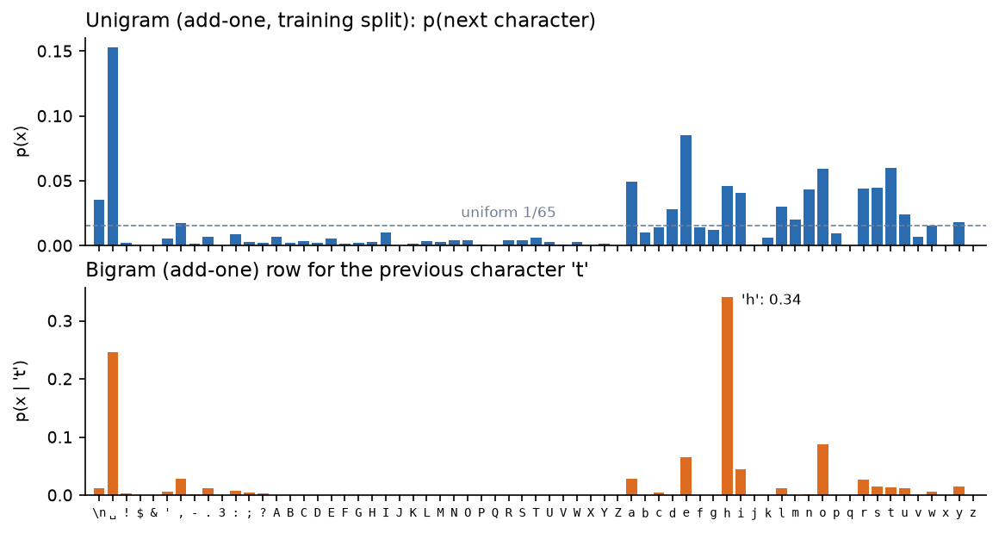
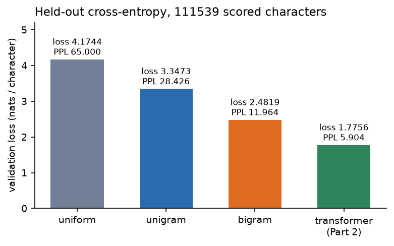
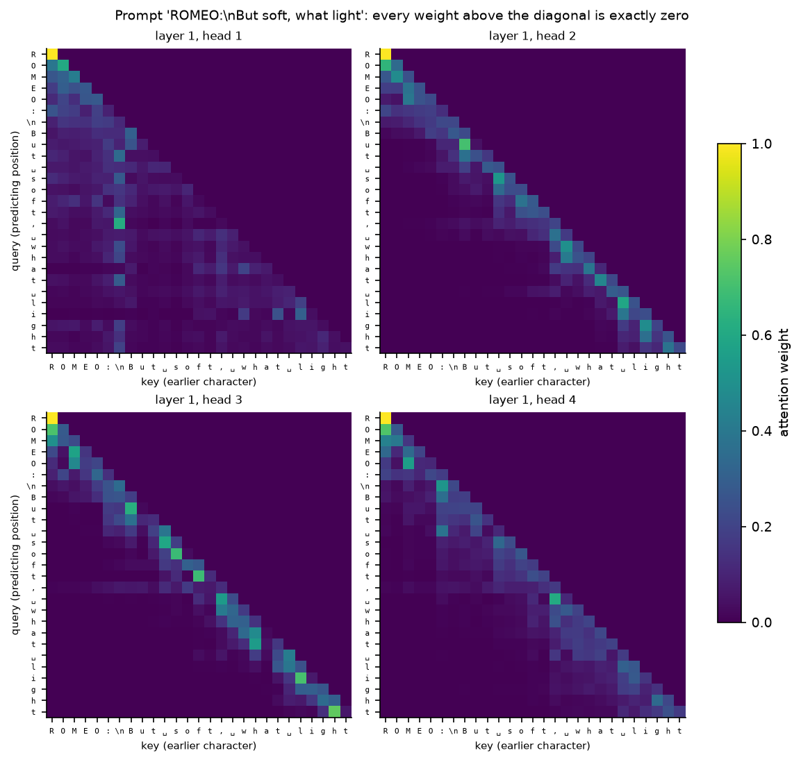
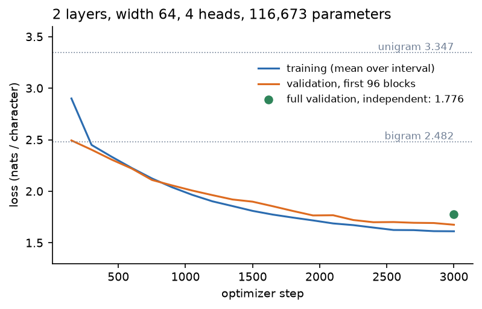
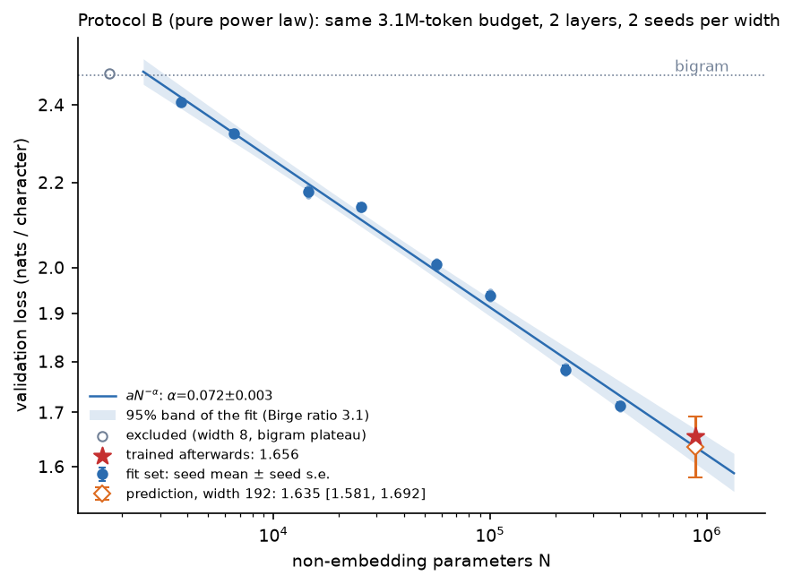
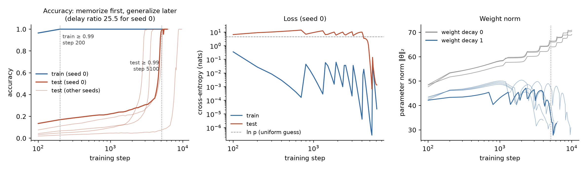
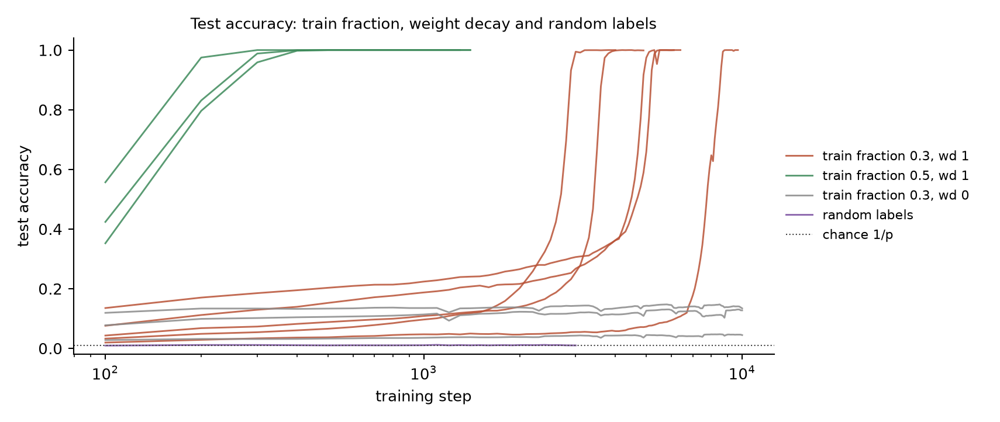
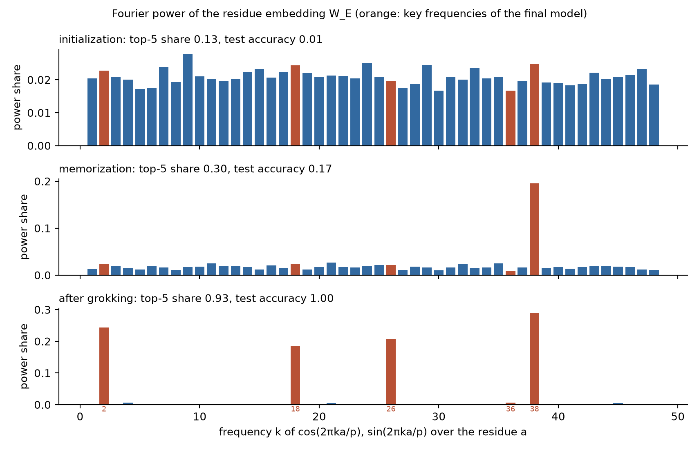
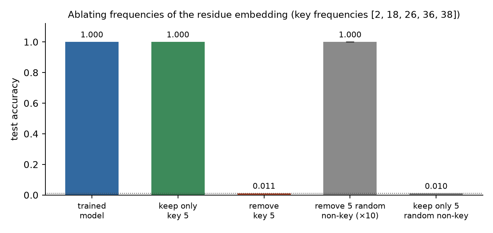

# Week 8: Autoregressive Models, Scaling and Grokking

Course exercise by Jin-Guo Liu and Xi-Wei Pan.

## 1. Environment and Dataset

All experiments were performed using JAX on CPU.

- OS: Ubuntu under WSL
- Python: 3.12.14
- uv: 0.12.21
- JAX: 0.10.2
- Optimizer: AdamW
- Corpus: TinyShakespeare
- Vocabulary: 65 sorted characters
- Training split: first 90%
- Validation split: last 10%
- Block size: 128
- Scored validation characters: 111,539

Corpus SHA-256:

`86c4e6aa9db7c042ec79f339dcb96d42b0075e16b8fc2e86bf0ca57e2dc565ed`

All commands below are run from the repository root.

## 2. Part 1: Character Probability Models

Three predictors were evaluated on the held-out corpus.

| Predictor | Cross-entropy | Perplexity |
|---|---:|---:|
| Uniform | 4.174387 | 65.000 |
| Unigram | 3.347305 | 28.426 |
| Bigram | 2.481889 | 11.964 |

Training characters: 1,003,854.

Validation characters: 111,540.

Scored characters: 111,539.

The two-target example gives loss 1.039721 and
perplexity 2.828427.

### Reproduction

`uv run --project week8/speedrun --python 3.12 python week8/cpu/baselines.py`

Figure generation:

`uv run --project week8/speedrun --python 3.12 --with matplotlib python week8/data/cpu-figures.py`

### Evidence

### Interpretation

Autoregressive models factorize sequence probabilities
into normalized next-token conditional probabilities.
Therefore, sequence likelihoods can be evaluated exactly.

Cross-entropy measures average negative log probability,
while perplexity is its exponential.

Increasing the available context lowers the held-out loss.
The bigram captures character dependencies, including
the high probability of 'h' following 't'.

## 3. Part 2: Causal Transformer

### Configuration

- Transformer layers: 2
- Model width: 64
- Attention heads: 4
- Context length: 128
- Batch size: 16
- Training steps: 3000
- Learning rate: 0.003
- Warmup steps: 100
- Final learning rate: 0.0003
- Weight decay: 0.1
- Seed: 1337
- Total parameters: 116,673

### Results

- Full validation loss: 1.775539
- Perplexity: 5.903550
- Scored characters: 111,539
- Causality probe maximum change: 0
- Maximum future attention weight: 0
- Maximum attention row-sum error: 2.38e-7
- Generated text: 500 characters at each temperature

### Reproduction

Training:

`JAX_PLATFORMS=cpu uv run --project week8/speedrun --python 3.12 python week8/cpu/part2.py week8/cpu/configs/part2.json --out "$PWD/week8/cpu/work/part2"`

Independent evaluation:

`uv run --project week8/speedrun --python 3.12 python week8/checker/evaluator.py --artifacts "$PWD/week8/cpu/work/part2" --out "$PWD/week8/cpu/work/part2/independent-eval.json"`

Recovering evidence from saved weights:

`JAX_PLATFORMS=cpu uv run --project week8/speedrun --python 3.12 python week8/cpu/finish_part2.py`

Figure generation:

`uv run --project week8/speedrun --python 3.12 --with matplotlib python week8/data/cpu-figures.py`

### Evidence

### Interpretation

The causal mask prevents every position from attending
to subsequent characters.

The causality probe confirms that changing future tokens
does not alter earlier predictions.

The transformer outperforms the bigram baseline.
Sampling at temperatures 0.5 and 1.0 produces different
levels of diversity without changing validation loss.

## 4. Part 3: Neural Scaling Law

### Configuration

- Transformer layers: 2
- Attention heads: 2
- Fit widths: 12, 16, 24, 32, 48, 64, 96, 128
- Excluded width: 8
- Held-out width: 192
- Seeds: 1 and 2
- Steps per run: 1500
- Batch size: 16
- Context length: 128

The scaling law is:

L(N) = a N^(-alpha)

where N counts non-embedding parameters.

### Results

- Alpha: 0.0717 +/- 0.0026
- Birge ratio: 3.099
- Held-out parameters: 889,728
- Predicted loss: 1.6350
- 95% prediction interval: [1.5809, 1.6917]
- Actual seed-mean loss: 1.6556
- Prediction interval contains actual result: True

Prediction timestamp (UTC):

2026-10-28T04:56:59.168221+00:00

First held-out training completion (UTC):

2026-10-28T04:59:55.100244+00:00

No width-192 runs were present when the prediction
was written.

### Reproduction

Fit-set training:

`JAX_PLATFORMS=cpu uv run --project week8/speedrun --python 3.12 --with scipy python week8/cpu/scaling.py train-fit week8/cpu/configs/scaling-b.json --jobs 2`

Prediction, run before held-out training:

`JAX_PLATFORMS=cpu uv run --project week8/speedrun --python 3.12 --with scipy python week8/cpu/scaling.py predict week8/cpu/configs/scaling-b.json`

Held-out training:

`JAX_PLATFORMS=cpu uv run --project week8/speedrun --python 3.12 --with scipy python week8/cpu/scaling.py train-held week8/cpu/configs/scaling-b.json --jobs 2`

Comparison:

`JAX_PLATFORMS=cpu uv run --project week8/speedrun --python 3.12 --with scipy python week8/cpu/scaling.py compare week8/cpu/configs/scaling-b.json`

Figure generation:

`uv run --project week8/speedrun --python 3.12 --with matplotlib python week8/data/cpu-figures.py`

### Evidence

[Timestamped blind prediction](evidence/part3-blind-prediction.json)

### Interpretation

Validation loss decreases approximately as a power
of non-embedding parameter count.

Width 8 was excluded because its loss remained near
the bigram plateau.

The Birge ratio accounts for scatter beyond seed noise
and broadens the uncertainty interval.

The blind prediction was timestamped before width-192
training and successfully included the observed loss.

A fitted irreducible floor term was not reliable over
the available range and could distort extrapolation.

## 5. Part 4: Grokking Modular Addition

### Configuration

- Task: c = (a + b) mod 97
- Transformer layers: 1
- Model width: 64
- Attention heads: 4
- MLP width: 256
- Training fraction: 30%
- Weight decay: 1.0
- Learning rate: 0.003
- Maximum steps: 10000
- Seeds: 0, 1, 2, 3, 4

### Memorization and Grokking

| Seed | Memorization | Grokking | Delay ratio |
|---|---:|---:|---:|
| 0 | 200 | 5100 | 25.5 |
| 1 | 200 | 5400 | 27.0 |
| 2 | 200 | 8700 | 43.5 |
| 3 | 200 | 3900 | 19.5 |
| 4 | 200 | 3000 | 15.0 |

Training accuracy reached 99% before test accuracy.
All five seeds subsequently generalized.

### Control Experiments

- Without weight decay, generalization remained poor.
- With 50% training data, generalization occurred earlier.
- With random labels, the model memorized but failed
  to generalize beyond chance.

### Fourier Mechanism

Top-five Fourier power shares:

- Initialization: 0.13
- Memorization: 0.30
- After grokking: 0.93

Identified key frequencies:

[2, 18, 26, 36, 38]

### Ablation Results

| Experiment | Test accuracy |
|---|---:|
| Full trained model | 1.000 |
| Keep only five key frequencies | 1.000 |
| Remove five key frequencies | 0.011 |
| Remove five random non-key frequencies | 1.000 |
| Keep only five random non-key frequencies | 0.010 |

### Reproduction

Main training:

`JAX_PLATFORMS=cpu uv run --project week8/speedrun --python 3.12 python week8/grokking/run_study.py --only main`

Control experiments:

`JAX_PLATFORMS=cpu uv run --project week8/speedrun --python 3.12 python week8/grokking/run_study.py --only frac05 wd0 random`

Figure generation:

`uv run --project week8/speedrun --python 3.12 --with matplotlib python week8/data/grokking-figures.py`

### Evidence

### Interpretation

Grokking is delayed generalization: the network
memorizes training examples long before discovering
a rule that generalizes to unseen inputs.

Weight decay favors more compact solutions and helps
the model transition from memorization to generalization.

Modular addition can be represented using Fourier modes.
After grokking, embedding power concentrates in a few
important frequencies.

Keeping only these frequencies preserves accuracy,
while removing them reduces accuracy to chance.
This provides causal evidence for the learned mechanism.

## 6. Reproducibility and Repository Hygiene

The environment is managed using uv and the course
package configuration.

The data fingerprint, model hyperparameters, random
seeds and evaluation protocol are recorded above.

Source code and evidence figures are retained in Git.
Downloaded corpora, checkpoints, virtual environments
and raw experimental outputs must be excluded.

All four experimental parts have been completed.
The evidence will be presented at the start of Week 9.
The final course project is defended in Week 13.
